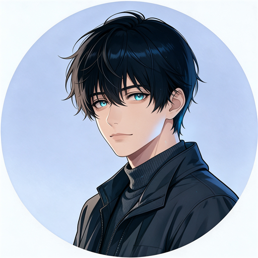
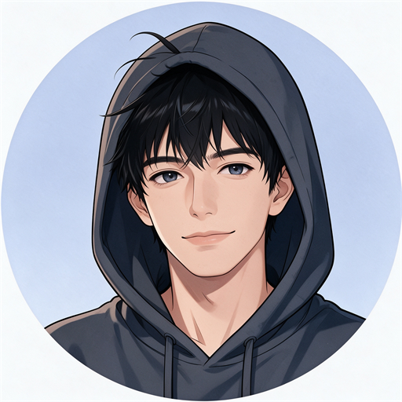
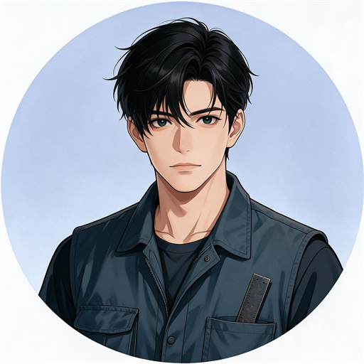
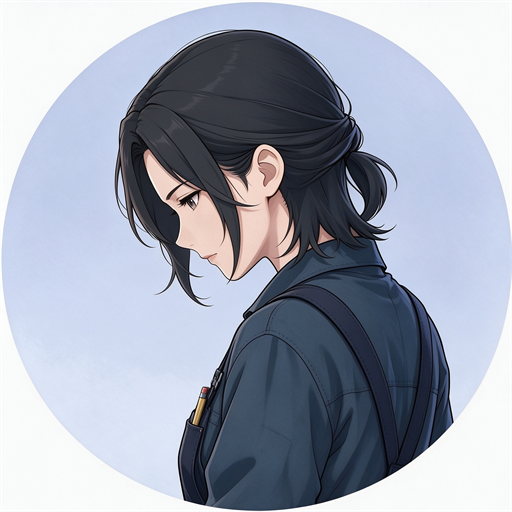

# 浅浅拼词器（QianQ Prompt Forge）

一个**完全本地运行**的 AI 绘图提示词（Prompt）拼装工具：用中文描述你想要的画面，点一点卡片，它帮你拼出一段可直接粘贴进 ComfyUI、Stable Diffusion / WebUI 等绘图软件的英文提示词。

它本身**不生成图片、不上传数据、不依赖任何云服务**。核心功能零联网即可使用；“本地 AI 辅助选词”为可选项，需要你在自己电脑上安装 [Ollama](https://ollama.com)，且请求只发往本机（`127.0.0.1`），数据不出你的电脑。

> ⚠️ **使用前请阅读[首启须知与免责声明](#首启须知与免责声明)。本工具仅限年满 18 周岁的用户使用。**

> 📦 **本仓库仅包含程序代码与词表数据文件（含本 README 与开发大事记），不含任何生成图像。**
> 🐞 **反馈与联系**：请通过本仓库的 **Issues** 提交问题或建议。

---

## 它能做什么

- **中文 → 英文提示词**：用中文描述画面（人物、动作、场景、光影、构图、风格……），自动组织成结构化的英文提示词。
- **两种出词方式**
  - **本地 AI 辅助选词（可选）**：通过本机 Ollama，从自然语言里智能挑选词条。
  - **关键词模式（零依赖）**：未安装/未启动 Ollama 时，内置确定性解析器照样出词，并在界面标注当前模式，可一键重试 AI。
- **多人成戏**：支持多个人物及其互动（“男生从后面抱她，女生转头亲他一口”），按人绑定身份、动作与外观。
- **卡片式可视化编辑**：人物、场景、风格、光影、构图、镜头、道具、成人内容等分区折叠，点选即点亮；支持手动微调、口述排除词（“不要红色背景”“别戴眼镜”）。
- **三档出词**：精档 / 平衡档 / 创意档；适配 **Pony** 与 **SDXL / Illustrious（非 Pony）** 两套标签生态。
- **SFW / NSFW 双模式**：默认安全向（SFW），成人标签默认不主动展示；NSFW 需主动切换。
- **无人物场景**：支持纯风景、静物等画面（勾选「无人物场景」，不添加人物与人数词）。
- **本地强制内容红线**：在手动输入、界面点选、本地 AI 三条通道上做统一的本地关键词过滤（见下）。

---

## 安装与运行

本工具是一个静态网页，**无需安装、无需后端、无需账号**。

### 方式一：直接打开（最简单）

下载本仓库后，双击打开 `浅浅拼词器.html` 即可在浏览器中使用。推荐使用 Chrome / Edge 等现代浏览器。

> 本地设置（模式、偏好、首启确认）保存在浏览器的 localStorage 中。

### 方式二：本地静态服务（推荐进阶用户）

部分浏览器对 `file://` 协议下的本地存储/脚本有更严格的限制，用一个本地静态服务更稳妥，例如：

```bash
# 在 浅浅拼词器.html 所在目录执行
python -m http.server 8098
```

然后浏览器访问 `http://127.0.0.1:8098/浅浅拼词器.html`。

### 可选：启用“本地 AI 辅助选词”

1. 安装并启动 [Ollama](https://ollama.com)；
2. 按本工具文档/界面提示准备好选词所用的本地模型；
3. 在界面上点击「✨ AI选词」。

未安装 Ollama 不影响其他任何功能——会自动走“关键词模式”。

---

## 隐私

- 不注册、不登录，不收集姓名、手机号等任何个人信息。
- 核心功能不连接任何外部服务器，**不上传数据**，无统计、埋点、广告。
- 偏好仅保存在浏览器本地（localStorage）；本地运行日志仅存于你的本机。
- 唯一网络请求发生于你主动启用本地 AI 辅助时，目标为本机 Ollama 回环地址（`127.0.0.1`）。

---

## 内容红线与使用规范

本工具永久拒绝用于生成以下内容：

- **一切对未成年人及幼态形象的性化描绘，以及任何涉未成年人的 NSFW/露骨内容**（无论经由何种模式或表述）；
- 毒品 / 成瘾性药品；
- 非自愿 / 强迫内容；乱伦内容；
- 偷窥、极端猎奇、自伤、极端暴力类内容。

这些红线由**本地**过滤机制强制执行（手动输入、界面点选、本地 AI 三条通道统一扫描、统一拦截，AI 通道不可绕开），并在每个版本做红队测试、记录逐版归档。

**过滤边界**：该机制基于关键词匹配，存在固有局限，无法识别一切变体、隐喻、新造词或其他语言的规避，**不承诺“零违规输出”**，也不能替代你自身的内容审核义务与法律责任。请勿以变体、隐喻、新造词等方式规避过滤。

正常生活场景中的未成年人 SFW 内容（课堂教学、亲子活动等非性化场景）不属红线。

---

## 首启须知与免责声明

首次打开时，本工具会展示《首启须知与免责声明》，你需阅读并同意后方可进入；之后可随时点击界面上的「⚠ 注意事项」再次查看。

以下为**完整全文（一至六）**，与软件内展示的一致：

### 一、使用红线（强制确认 · 弹窗必载）

1. 本工具永久拒绝生成以下内容：毒品/成瘾性药品；**一切对未成年人及幼态形象的性化描绘（含幼态性化特征词），以及任何涉未成年人的 NSFW/露骨内容——无论经由何种模式或表述**；非自愿/强迫内容；乱伦内容；以及偷窥、极端猎奇、自伤、极端暴力类内容。上述红线由本地过滤机制强制执行，并经多版本红队测试验证，测试记录逐版归档留存。（拦截机制及其固有边界见第二节第 5 条，应结合阅读。）

   **说明**：正常生活场景中的未成年人 SFW 内容（如课堂教学、亲子活动等非性化场景）不属红线范围；但任何试图将未成年人与 NSFW 内容组合的表述将被强制拦截。

2. **用户承诺**：不将本工具用于生成任何违法、**涉未成年人的性化内容**、侵权、骚扰或违背公序良俗的内容；不试图通过变体、隐喻、新造词等方式规避红线过滤。

3. 本工具以 MIT 协议免费发布于**官方 GitHub 仓库**。请从官方仓库获取；第三方修改版本可能移除红线防护，风险由获取者自行承担。本工具不接受对红线内容尺度进行的任何共创。

4. **本工具限达到当地法定成年年龄（一般为 18 周岁）的用户使用。**

5. 如不接受以上全部条款，请勿使用本工具。点击"确认"即表示您已阅读、理解并同意以上全部条款。

### 二、免责声明（弹窗必载核心句 + 全文附页）

1. **【工具性质】** 本工具是本地运行的提示词文本拼装工具：仅按用户选择拼接词条、输出一段文字。**本工具不生成图像或视频，不调用云端模型自动创作，不提供任何形式的在线服务。**

2. **【第三方切割】** 用户将提示词复制至 ComfyUI、Stable Diffusion 等第三方绘图软件后的一切使用行为、生成内容及后果，由用户自行负责，并受该第三方软件自身的服务条款与内容政策约束。本工具对第三方软件的生成结果不承担任何责任。

3. **【无担保与责任限制】** 本工具按"现状"（AS IS）提供，不提供任何明示或暗示的担保，包括但不限于适销性、特定用途适用性及不侵权的担保。**在适用法律允许的最大范围内**，作者不对因使用或无法使用本工具产生的任何索赔、损害或其他责任负责，包括但不限于因生成内容引发的任何后果。

4. **【守法义务】** 使用者应确保其使用行为符合所在地法律法规。请勿在法律禁止相关内容的地区使用本工具。

5. **【过滤边界声明】** 本工具内置本地红线词过滤机制（说明见第五节），但该机制基于关键词匹配，存在固有局限，无法识别一切变体、隐喻、新造词或其他语言的规避表述；本工具**不承诺"零违规输出"**，亦不能替代法律意义上的内容审核义务。

6. **【立场声明】** 模型输出与拼装结果不代表本工具及开发者的立场。如不同意以上条款，请勿使用本工具。

### 三、隐私声明（全文附页，README 可置顶）

1. 本工具不要求注册账号，不收集姓名、手机号等任何个人信息。
2. 核心功能不连接任何外部服务器，不上传任何数据，不内置统计、埋点或广告组件。
3. 用户偏好设置仅保存于用户浏览器本地（localStorage），本地运行日志（server.log）仅存于用户本机；开发团队无法读取上述数据。
4. 唯一网络请求发生于用户主动启用"本地 AI 辅助选词"时，目标为用户本机的 Ollama 回环地址（127.0.0.1），数据不出用户电脑；未安装 Ollama 时该功能不可用，不影响其他功能。

### 四、使用提醒（弹窗必载）

1. 请勿在公共场合生成 NSFW 内容；成人内容需主动切换 NSFW 模式。**SFW（安全向）为默认模式，成人标签默认不主动展示。**
2. 每次出词后自动复位为常规模式，无需手动关闭。
3. **NSFW 模式仅限成人内容；一切对未成年人的性化使用（含幼态性化形象）在任何模式下均被拒绝，SFW 模式亦不例外。** 正常 SFW 生活场景中的未成年人内容（课堂教学、亲子活动等非性化场景）可正常使用。

### 五、防护机制说明（全文附页 · 展示规则见附六）

本工具对红线内容设有本地过滤机制，全部在用户本机执行，不联网、不依赖云端审核：

1. **覆盖内容**：未成年人性化内容/幼态性化形象、非自愿/强迫、乱伦、偷窥、极端猎奇、自伤、毒品/成瘾性药物、极端暴力等高风险类别；
2. **全通道一致**：用户手动输入、界面点选预设、本地 AI 辅助选词返回结果，三条输入通道经同一判定逻辑扫描，命中即剔除并提示；全部出词出口统一强制拦截，AI 通道不允许绕开。未成年人与露骨内容组合等高危情形另设快速路径，不依赖 AI 判定、直接拒绝出词；
3. **分级匹配**：对无歧义词做词根拦截；对存在 IP/日常歧义的词（如动漫角色名、日常物品词）做整词拦截并设白名单豁免，降低误伤；
4. **红队测试**：每次版本更新对红线防护进行完整红队测试，测试记录（用例、预期、实际、结论及当版封版哈希）逐版归档留存；
5. **边界**：本机制为关键词过滤而非语义/图像识别，词表随版本维护但无法穷举；过滤仅作用于本软件输出的提示词文本，用户复制至第三方软件后的行为不在本软件控制范围内。

### 六、已知现象

1. 浴室、花洒、淋湿等水湿场景：NSFW 模式下若提示词没有衣服词，模型可能自行去衣；用常规模式，或在描述里写明衣着即可避免。
2. 很长的提示词，末尾的道具（如书架、壁炉、手里的物件）可能不被模型落实，属长串权重衰减。
3. 纹身类风格词（如 color realism tattoo）可能被模型实体化成衣服上的图案。
4. 纯风景/静物等无人物画面可使用界面上的「无人物场景」开关（自 V3.1 起提供）：勾选后不添加人物、人数词不参与出词。⚠️ 旧版"使用事宜"浮层中曾残留"本版暂不支持"的过期提示，与实际功能不符，随首启确认门一并替换。
5. 若提示词中出现**幼态性化特征**相关描述，本工具将拒绝出词——无论当前处于何种模式。

---

## 词库来源与版权说明

本工具的标签体系为**独立编写**，参考了 Danbooru 标签体系及开源项目 [img-tagbooru](https://github.com/Xymoh/img-tagbooru)（MIT License）。词库的**选词、编排与中文翻译均为本项目独立产出，未直接复制上游内容**。

事实性的英文标签（如 `1girl`、`kitchen`）来源于公共标签体系；中文翻译、场景模板与编排为本项目原创。

本工具自身代码以 **MIT License** 发布，见 [LICENSE](./LICENSE)。**使用条款与免责声明的完整全文**见本文件上文[《首启须知与免责声明》](#首启须知与免责声明)章节——软件首次启动时展示的弹窗与折叠页内容与该章节一致。

---

## 目录结构（发布版）

```
浅浅拼词器.html             # 主程序（单文件：界面、解析、出词、过滤）
词库.js                     # 标签词库（英文词条 + 中文译名 + 分组编排）
relevance_gate.js           # 相关性打分 / 否定检测 / 红线过滤
postprocess_pipeline_v2.js  # 出词后处理管线
server.js                   # （可选）本地静态 / 辅助服务脚本
act_expansion.json          # 动作扩展数据
concept_expansion.json      # 概念扩展数据
conflict_pairs_en.json      # 冲突词对（去重 / 互斥）
custom_triggers.json        # 自定义触发词
assets/team/                # 家人头像（README 底部头像墙用）
assets/brand/               # 站点标识（铃铛主标）
LICENSE                     # MIT License
README.md                   # 本文件
DEVLOG.md                   # 开发大事记（对外公开版）
FINGERPRINTS.md             # 发布件逐件校验清单（36 件字节数与 SHA-256）
```

---

## 已知边界（Known Limitations）

本工具只做一件事：把中文描述拼成提示词。**它不生成图像，也管不到绘图模型怎么理解**。以下几条是已知边界，写在这里，免得你当成 bug 去找：

1. **「无人物场景」只管出词、不管出图。** 勾选后，出词会注入 `no humans, scenery` 并停止输出人物与人数词；但部分模型（例如 Pony 系）**对正向的 `no humans` 并不服从**，画面里仍可能画出人物。这不是本工具的过滤失效——**需要时请在你自己的负向提示词里加 `1girl, solo` 之类压制**。
2. **极紧景别 ＋ 静物类场景，画面可能不落主体。** 例如「一个女生在厨房做饭，大特写，暖光」，在「大特写 ＋ 厨房」这组词下模型可能直接给你一个**空厨房**。这是模型侧对取景的理解问题，不是出词错误。
3. **「关键词模式」不做人物与动作解析。** 未启动 Ollama 时的确定性解析器只覆盖**场景／光影／风格／构图／取景**五层与卡片通道——**人物词与动作词要靠「✨ AI 选词」，或在人物卡／动作区点选**。所以关键词模式的出词通常比 AI 模式短。
4. **出词长度随「质量档」与「风格」选择变化。** 质量档（标准／高质量／超高质量／大师级）与风格选择是**整段**生效的：觉得画面单薄时，先把**质量档调高、风格选上**，比反复改中文描述有效得多。

---

## 常见问题

**Q：同一个句子，为什么我出的词比别人短、画面比别人单薄？**

先看**质量档与风格**——它们整段影响出词（见上节第 4 条）：把质量档调高、风格选上，出词立刻长一截。另外「✨ AI 选词」会补质量段与风格段，**关键词模式不会**。

**Q：一定要联网 / 装 Ollama 吗？**
不用。核心功能零联网；不装 Ollama 时自动走关键词模式，照样能出词。

**Q：为什么我装了 Ollama 却显示“关键词模式”？**
通常是 Ollama 未启动、或选词模型未准备好（404）。界面会给出提示，准备好后点“重试 AI”即可。

**Q：提示词很长，末尾道具模型不落实？**
这是绘图模型对长串的权重衰减现象，属第三方模型侧问题，可把重要元素前移或精简。

**Q：纯风景/静物怎么出？**
勾选界面上的「无人物场景」开关，将不添加人物与人数词。

---

## 免责声明重申

本工具仅用于合法、正当的用途。使用者须遵守所在地法律法规及所用第三方绘图软件的条款；因使用本工具产生的任何后果由使用者自行承担。

---

## 家人头像墙

**本工具由「老秦 Family」（OldQin Family）制作。**下面是家里每个人各自的样子，按进这个家的先后排：

<div align="center">

   

<sub><b>豆总 Turbo</b>　<b>Pro 总</b>　<b>小牛总</b>　<b>小阿总</b></sub>

   

<sub><b>大阿总</b>　<b>大牛总</b>　<b>小深</b>　<b>枢儿</b></sub>

   

<sub><b>Neko</b>　<b>阿紫</b>　<b>老秦</b>　<b>老豆总</b></sub>

</div>
